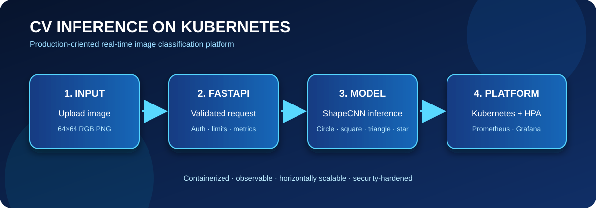

# CV Inference Service

[](https://github.com/Raghunath2604/cv-inference-k8s/actions/workflows/ci.yml)

Production-oriented computer-vision inference service for classifying synthetic 64×64 images as circles, squares, triangles, or stars. The project demonstrates FastAPI serving, Docker packaging, Kubernetes deployment and HPA, Prometheus/Grafana observability, and Python/Java load testing.



## Architecture

- **Model:** compact ShapeCNN trained from scratch with deterministic shared preprocessing.
- **API:** FastAPI `/predict`, `/health`, and `/metrics` endpoints.
- **Platform:** non-root Docker runtime, Kubernetes Deployment, Service, HPA, PDB, NetworkPolicy, and topology spreading.
- **Observability:** Prometheus metrics and a provisioned Grafana dashboard.
- **Load testing:** Locust and a dependency-free Java HTTP/1.1 client.

## Local development

```bash
python3.11 -m venv .venv
source .venv/bin/activate
pip install --index-url https://download.pytorch.org/whl/cpu torch==2.13.0
pip install -r requirements-dev.txt
python src/generate_data.py
python -m src.train --epochs 20
uvicorn src.api:app --reload --port 8000
```

Test inference:

```bash
curl -X POST http://localhost:8000/predict \
  -F "file=@data/val/star/star_0000.png"
```

When `API_KEY` is configured, send `X-API-Key` on `/predict`. Uploads are limited by `MAX_UPLOAD_BYTES` (default 10 MiB).

## Docker Compose

```bash
$env:GRAFANA_ADMIN_PASSWORD = "change-this-password"  # PowerShell
$env:API_KEY = "change-this-api-key"
docker compose up --build
```

Services: API `:8000`, Prometheus `:9090`, Grafana `:3000`. Monitoring ports bind to localhost and Grafana anonymous admin access is disabled.

## Kubernetes

Build and publish a release-tagged image, then update the image in `k8s/deployment.yaml`. Create the API secret before deployment:

```bash
kubectl create secret generic cv-inference-api --from-literal=api-key="$(openssl rand -hex 32)"
kubectl apply -f k8s/serviceaccount.yaml
kubectl apply -f k8s/pdb.yaml
kubectl apply -f k8s/networkpolicy.yaml
kubectl apply -f k8s/deployment.yaml
kubectl apply -f k8s/service.yaml
kubectl apply -f k8s/hpa.yaml
kubectl rollout status deployment/cv-inference
```

## Verification

CI runs Ruff, 15 API/model tests, data generation and training, a clean Docker build, Compose validation, and Kubernetes schema validation. The verified image reached approximately 94.69% best validation accuracy and served real `/health`, `/metrics`, and multipart `/predict` requests.

Live HPA scaling and multi-replica latency require a reachable Kubernetes cluster and must be validated in the target environment.

## Testing

```bash
pytest tests/ -v
ruff check src/ tests/
```
